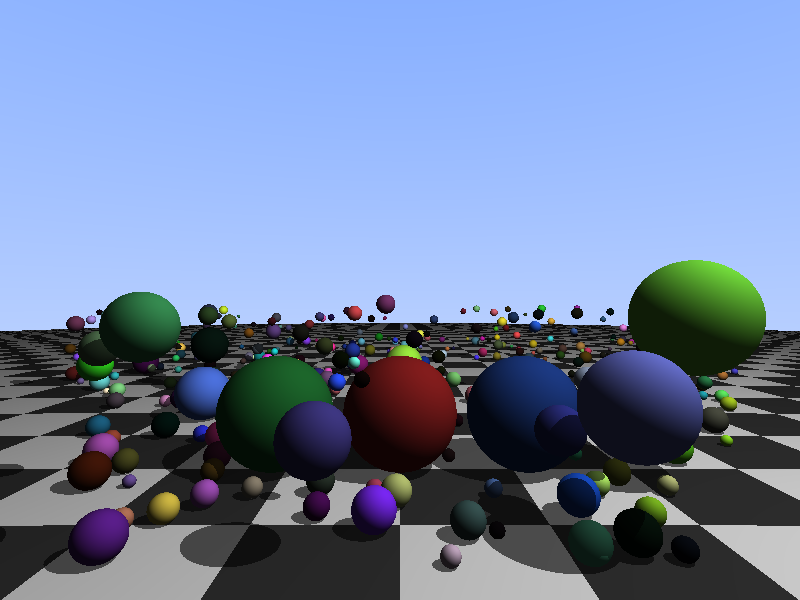
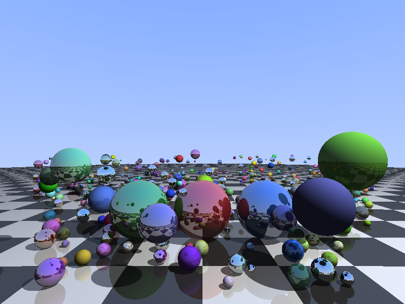
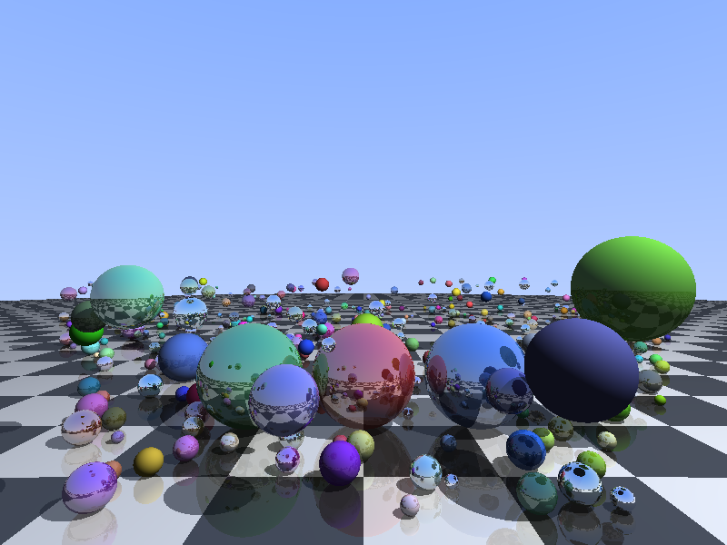

# CUDA Ray Tracing: from a CPU port to a BVH

CS6023 course project. This report follows the project in the order it was done: port the CPU ray
tracer to CUDA, add multi-bounce reflections, scale the scene up until the GPU has real work, then
profile, form a hypothesis, change one thing, and measure again. Each section says why the step was
taken, what the profile showed, and what changed. Two of the attempts did not help; they are
reported with the reason.

Raw numbers, intermediate profiles and side checks are in `FINDINGS.md` (section numbers are given
as "F§n"). All source files are in `src/`, all scripts in the project root.

---

## 1. Setup and measurement method

| Item | Value |
|---|---|
| GPU | NVIDIA Tesla T4 (Turing, CC 7.5), 40 SMs, Google Colab |
| Toolchain | nvcc 13.0, `-O2 -std=c++11` |
| Profilers | Nsight Systems 2025.3.1, Nsight Compute 2025.3.1 |
| Image | 800 × 600 unless stated otherwise |
| Default render | depth 10, energy threshold 0.01 |

**How times are measured**
- **Kernel only, with CUDA events,** around the launch, after one untimed warm-up run. Without
  the warm-up, the first run of a session took 2.37 ms at N=10 where the others took 0.23 ms (GPU
  clock ramp).
- **Several runs per point** (3–20), averaged by the scripts (`run.sh`, `compare_sizes.sh`,
  `compare_blocks.sh`, `compare_depth.sh`, `compare_resolution.sh`, `compare_cpu.sh`).
- **Comparisons are made within one Colab session.** Between sessions the same binary varied by
  up to ~7 % (baseline at N=5000: 78.1–84.0 ms). One optimization (prefetch, §9.2) looked like a
  gain across sessions and turned out to be a loss within one.
- **Correctness:** every new version renders N=400 and is compared pixel by pixel with its
  predecessor (`compare_images.py`). Every version is either identical or the difference is explained.
- **Profiles:** `profile.sh` runs nsys, then `ncu --set full`, then a set of raw FLOP and byte
  counters for a hand-made roofline. **ncu locks the SM clock at 585 MHz** (boost is ~1590 MHz), so
  ncu durations are ~2.6× the event timings. Profile numbers are compared with each other, never
  with event timings.

---

## 2. Starting point: porting the CPU ray tracer

### 2.1 The CPU code

`starter_raytracer_cpu.cpp` renders 3 spheres on a checkerboard floor (the floor is a sphere of radius
1000). For each pixel it builds a camera ray, finds the closest sphere hit, shades it with diffuse
lighting plus ambient, and casts one shadow ray towards the light. Two nested loops over the pixels,
one thread.

### 2.2 CUDA mapping (`src/baseline.cu`)

Every pixel is independent, so the mapping is **one thread per pixel** on a 2D grid:

```cpp
int px = blockIdx.x * blockDim.x + threadIdx.x;
int py = blockIdx.y * blockDim.y + threadIdx.y;
if (px >= W || py >= H) return;            // the grid is rounded up to whole blocks
```

- Blocks of 32×32 threads (the maximum, 1,024), grid ⌈800/32⌉ × ⌈600/32⌉ = 25 × 19 = 475 blocks.
  600 is not a multiple of 32, so the bottom row of blocks has 8 rows of idle threads (hence the
  bounds check).
- A warp is 32 consecutive `threadIdx.x`, so with 32-wide blocks **one warp = one row of 32 pixels**.
  This matters later for divergence (§8).
- The scene is copied to global memory once; the image is copied back once.
- The device code is the CPU code with `__device__` added; the image matches the CPU's except for
  4 of 480,000 pixels that differ by 1/255 (the GPU contracts `a*b+c` into one FMA instruction, which
  rounds once instead of twice).

### 2.3 CPU vs GPU (`compare_cpu.sh`, F§13.1)

| 800×600, 3 spheres | Time |
|---|---|
| CPU, `g++ -O2`, 1 thread (whole process) | 47.1 ms |
| GPU kernel (CUDA events) | **0.159 ms** (296× faster) |
| GPU, whole process | 240.5 ms (5× *slower* than the CPU) |

The kernel is ~300× faster, but the GPU program as a whole is slower: almost all of its 240 ms is
CUDA context creation (nsys: the first `cudaMalloc` alone takes ~180 ms) and setup. A 3-sphere scene
is far too small to say anything about GPU efficiency, so the rest of the project uses larger scenes
and times only the kernel.

---

## 3. Multi-bounce reflections

### 3.1 From recursion to a loop

Reflection is naturally recursive: the colour seen along a ray = local shading + k × colour seen along
the reflected ray. Deep recursion is a poor fit for a GPU (each thread has a small stack, and
recursion depth differs between threads), so the bounce chain is written as a loop with an
**energy accumulator** (`src/multi_reflections_naive.cu`):

```cpp
float curr = 1;                                   // how much this bounce still contributes
do {
    depth--;
    hit = closestHit(origin, dir, ...);
    if (hit < 0) { color += sky(dir) * curr; break; }      // ray left the scene
    ... local shading + shadow ray ...
    color = color + local * curr * (1.0f - k);    // k = reflectivity of the surface
    curr *= k;
    origin = p + n * 0.001f;                      // offset to avoid hitting the same surface
    dir = normalize(dir - n * 2 * dot(dir, n));   // r = d - 2 (d.n) n
} while (depth >= 0);
```

Every sphere and the floor have their own reflectivity `k`. Depth 0 = no reflection bounce.

### 3.2 Stopping conditions

The loop ends when (a) the maximum depth is reached, (b) the ray misses everything (sky), or
(c), added in `multi_reflections_threshold.cu`, **the remaining energy `curr` drops below a threshold**
(default 0.01): after that, further bounces cannot change the pixel noticeably.

A second small change: **shadow rays only need to know whether anything blocks the light**, not what
is closest. `closestHit` returns at the first hit when called for a shadow ray (`if (shadow && t > 0)
return i;`). This was not measured separately.

`multi_reflections_timed.cu` adds CUDA-event timing and command-line parameters (N, depth,
threshold). **It is the baseline for everything that follows.**

### 3.3 Effect of depth on time and image (`compare_depth.sh`, F§13.2)

Kernel time against maximum depth, N=400. "best" is the final flat version of §10 (shown here for
comparison):

| depth | t = 0.01: baseline / best | t = 0 (no threshold): baseline / best |
|---|---|---|
| 0 | 1.784 / 1.410 ms | 1.703 / 1.290 ms |
| 1 | 2.552 / 1.866 | 2.387 / 1.849 |
| 2 | 3.048 / 2.240 | 3.071 / 2.243 |
| 3 | 3.545 / 2.552 | 3.618 / 2.565 |
| 5 | 4.027 / 2.799 | 4.481 / 3.046 |
| 10 | 4.108 / 2.825 | 5.825 / 3.804 |

- **With threshold 0.01, time stops growing at about depth 5:** by then the threshold (or a sky miss)
  has stopped almost every ray, so a larger maximum depth is never reached.
- **Without the threshold,** time keeps growing, though each level costs less (rays still stop at
  sky misses). At depth 10 the threshold saves 26–29 %.

Image change from one depth to the next (best version, N=400, threshold 0.01; images in
`depth_images/`):

| step | pixels that change | mean change (of 255) |
|---|---|---|
| 0 → 1 | 44.9 % | 21.2 |
| 1 → 2 | 18.9 % | 3.1 |
| 2 → 3 | 6.8 % | 0.40 |
| 3 → 4 | 2.2 % | 0.06 |
| 4 → 5 | 0.16 % | 0.005 |
| 8 → 9, 9 → 10 | 0 | 0 |

| depth 0 | depth 1 | depth 3 | depth 10 |
|---|---|---|---|
|  |  |  |  |

Depth 1 adds the reflections in the mirror spheres and the floor; depths 2–3 add reflections of
reflections between neighbouring spheres; from depth 4 on, the changes are invisible.

### 3.4 Making the scene big enough

At N=3 the kernel takes 0.16 ms, which is too short to profile meaningfully. The scene was extended to
**5,000 small spheres** (`src/scene.h`: the first 20 hand-placed, the rest random, non-overlapping,
radius 0.04–0.12, seed 6023). Every program takes N on the command line and renders the floor plus
the first N spheres, so one scene file covers all sizes.

Baseline time is linear in N (`run.sh`, F§1): 0.99 ms at N=100, 1.96 ms at 200, 4.11 ms at 400, i.e.
**~0.01 ms per sphere**. That is expected: every ray (primary, every bounce, every shadow ray) tests
every sphere.

---

## 4. Profiling the baseline (N=400)

### 4.1 Where does the time go? (nsys, F§2)

| What | Time |
|---|---|
| First `cudaMalloc` (context creation) | 179.6 ms, one-time |
| `renderKernel` | 9.74 ms (no warm-up in this run) |
| Image copy device → host (1.44 MB) | 0.11 ms |
| Scene copy host → device | 0.003 ms |

The kernel is ~99 % of GPU time; transfers are negligible. All further work is inside the kernel.

### 4.2 Speed of Light (ncu, F§3.1)

| Unit | % of peak |
|---|---|
| Compute (SM) | 66.1 |
| Memory | 66.1 |
| L1/TEX cache | 72.4 |
| L2 cache | 0.04 |
| DRAM | 0.06 |

The scene (400 × 36 B ≈ 14 KB) sits in L1 after the first touch: L1 hit rate 99.9 %, L2 and DRAM idle.
Neither side is saturated; ncu calls it "compute and memory well-balanced".

### 4.3 Which line, which instruction (Source page, F§3.6)

About **98 % of all stall samples** are in the sphere loop (`hitSphere` and `closestHit`). The single
hottest line is the first one that uses the sphere's data:

| Line | Stall samples |
|---|---|
| `Vec3 oc = origin - s.center;` | **23.7 %** |
| `dot(...)` (inlined) | 12.5 % |
| `operator-` (inlined) | 9.7 % |
| `float disc = b*b - 4*a*c;` | 9.5 % |
| `if (disc < 0) return -1.0f;` | 7.6 % |

The SASS for that line shows **four separate 32-bit loads** (`LDG.E.SYS`) for `center.x`, `center.y`,
`center.z` and `radius`. The `Sphere` struct is 36 bytes (center, radius, color, reflectivity,
isFloor) and only 4-byte aligned, so the compiler cannot use one wide load. Every sphere test therefore
issues 4 load instructions.

### 4.4 The bytes-vs-requests trap (F§4.3)

Both 66 % headline numbers come from load *instructions*, not from arithmetic or bytes:

| Breakdown metric | % |
|---|---|
| L1: LSU-in requests | **66.1** (= the "Memory" SoL number) |
| SM: instructions issued to the LSU pipe | **66.1** (= the "Compute" SoL number) |
| SM: FMA pipe active | 56.5 |
| L1: data bank reads | 0.5 |

All 32 threads of a warp read the *same* sphere field, so L1 serves one value to all lanes: each request
moves almost no data but still occupies a request slot. A byte-based roofline therefore shows L1 as
about one third used, while by request rate it is the busiest unit.

### 4.5 Stalls, divergence, occupancy (F§3.3–3.5)

| Stall (cycles per issued instruction) | |
|---|---|
| Wait (dependency on the previous math result) | 2.48 |
| Not selected (ready, another warp issued) | 2.43 |
| Math pipe throttle (FP32 pipe busy) | 1.55 |
| LG throttle (global load queue full) | 0.54 |
| Long scoreboard (waiting for memory data) | 0.34 |
| total | 9.32 |

- **Waiting is mostly arithmetic:** each `dot` is a 3-instruction dependent chain (FMUL → FFMA →
  FADD), and `disc` is another. Memory latency is small because everything hits L1.
- **Divergence:** 21.7 of 32 threads active per instruction on average. Neighbouring pixels in a row
  bounce different numbers of times.
- **Occupancy:** 44 registers × 1,024 threads = 45,056 registers, so exactly **one block per SM**
  (65,536 registers). Theoretical occupancy is 100 %, achieved 77.6 %: when some warps of a block finish
  early (sky pixels: one pass; mirror pixels: up to 11 bounces), their slots stay empty until the
  whole block finishes.

### 4.6 Roofline (F§4)

FLOPs = fadd + fmul + 2·ffma = 8.71 G in 10.74 ms = **811 GFLOP/s, 27 % of the FP32 peak** at 585 MHz
(40 SMs × 64 lanes × 2 × 0.585 GHz = 2,995 GFLOP/s). Against DRAM the arithmetic intensity is
~3,900 FLOP/byte, far right of the ridge (9.4). No double-precision instructions.

**Summary of the baseline:** the load-instruction side (4 scalar loads per sphere test) is the
busiest unit, warp waiting is dominated by arithmetic dependency chains, a third of the lanes are idle
from divergence, and occupancy loses ~22 % to whole-block retirement. DRAM, L2, transfers and register
spills are not issues.

---

## 5. Optimization 1: scene in shared memory (`multi_reflections_shared.cu`)

**Why:** the 4 loads per sphere test go through the global-memory path. Copying the scene into shared
memory once per block replaces them with shared-memory loads.

**Change:** each block cooperatively copies `scene[0..N]` into dynamic shared memory, then
`__syncthreads()`, then all tests read the shared copy. The T4 allows at most 64 KB per block, i.e.
**1,820 spheres** of 36 bytes. Image identical to the baseline.

| N | baseline | shared | speedup |
|---|---|---|---|
| 10 | 0.266 ms | 0.149 ms | 1.79× |
| 100 | 0.991 | 0.830 | 1.19× |
| 400 | 4.105 | 3.717 | 1.10× |

Profile at N=400 (F§7):

| | baseline | shared |
|---|---|---|
| Duration (ncu) | 10.75 ms | 10.02 ms (−7 %) |
| Memory SoL / LSU pipe | 66.1 % | 45.4 % |
| FMA pipe | 56.5 % | 60.7 % (now the busiest pipe) |
| FLOPs, active threads, occupancy | – | unchanged |

- The SASS now has **one 128-bit shared load** (`LDS.U.128`) where the baseline had 4 scalar global
  loads: the compiler knows the alignment of the shared array. This explains the ~7 % fewer instructions.
- The gain is modest because the data was already in L1: shared memory and L1 are the same SRAM on
  Turing. Divergence and occupancy were not targeted and did not change.

---

## 6. Larger scenes: the L1 capacity cliff (`compare_sizes.sh`, F§8–9)

### 6.1 The cliff

Sweeping N up to 5,000 (baseline vs shared, depth 10, threshold 0.01):

| N | baseline | shared | ms per extra sphere (baseline) |
|---|---|---|---|
| 400 | 4.10 ms | 3.71 ms | – |
| 1364 | 13.66 | 12.61 | 0.0100 |
| 1500 | 15.50 | 13.91 | 0.0135 |
| 1700 | 19.33 | 15.83 | 0.0192 |
| 1819 | 24.35 | 17.02 | **0.0422** |
| 1820 | 24.26 | fails (64 KB limit) | – |
| 3000 | 44.85 | – | 0.0169 |
| 5000 | 78.84 | – | 0.0173 |

- The baseline costs ~0.0099 ms per sphere up to ~1,364 spheres, then gets worse, **thrashes at ~1,800**
  (4.3× the normal per-sphere cost) and settles at **~1.7×** above 2,500 spheres.
- 1,800 spheres × 36 B ≈ 64 KB: this is where the scene stops fitting in the L1 cache. Above that, each
  scan of the sphere list misses L1 and is served from L2 (4 MB, so it holds the whole scene).
- The cliff starts before 64 KB: a cyclic scan close to cache capacity evicts lines just before they are
  reused.
- Shared memory stays flat until its hard limit, and its advantage grows near the cliff (1.43× at
  N=1819): explicitly managed storage is never evicted.

### 6.2 Profile at N=5000 (F§9)

| | N=400 | N=5000 |
|---|---|---|
| Duration (ncu) | 10.75 ms | 184.3 ms (1.37× the cost per sphere) |
| SM / L1 SoL | 66.1 / 72.4 % | 51.5 / 55.5 % |
| L1 hit rate | 99.9 % | 98.6 % |
| L2 bytes | 3.5 MB | 518.6 MB (148×) |
| Cycles with no eligible warp | 29.7 % | 45.5 % |
| Achieved occupancy | 77.6 % | 72.1 % |

| Stall | N=400 | N=5000 | change |
|---|---|---|---|
| long scoreboard (waiting for L1 misses) | 0.34 | **2.14** | +1.80 |
| LG throttle (load queue full) | 0.54 | **1.43** | +0.89 |
| all others | 8.44 | 7.86 | −0.58 |
| total | 9.32 | 11.43 | +2.11 |

- **The entire slowdown is memory stalls.** Every unit is *less* busy than at N=400, and L2 bandwidth
  is essentially unused (0.3 %): the kernel waits for data, it is not short of bandwidth.
- **Why the hit rate still looks high:** all 32 threads of a warp read the same sphere (one request),
  and the warps of an SM scan the list roughly in step, so the first warp misses and the following ones
  hit. Capacity misses destroy reuse *between* scans, about one miss per cache line per scan against
  dozens of hits. The miss count, not the rate, is what matters (148× the L2 traffic).
- **LG throttle points at the number of load instructions:** with misses outstanding, the 4 scalar loads
  per sphere fill the load queue.

---

## 7. Optimization 2: hot/cold data split (`multi_reflections_split.cu`)

**Why:** the intersection test needs only center + radius (16 of the 36 bytes). §6 showed two costs:
L1 misses (capacity) and too many load instructions (LG throttle). A separate, 16-byte-aligned array of
`float4 (cx, cy, cz, r)` attacks both: 2.25× more spheres fit in L1, and one 128-bit load replaces four
32-bit loads. The full `Sphere` array is still used, but only for the sphere that was hit (normal,
colour, reflectivity).

```cpp
std::vector<float4> active_scene(sceneSize);          // host side
for (int i = 0; i < sceneSize; ++i)
    active_scene[i] = make_float4(s.center.x, s.center.y, s.center.z, s.radius);
...
float4 s = active_scene[i];                           // device: one LDG.E.128
```

CUDA's built-in `float4` is guaranteed 16-byte aligned; a hand-written 16-byte struct would only be
4-byte aligned and would still compile to 4 scalar loads.

**Profile at N=5000** (F§10):

| | baseline | split |
|---|---|---|
| Duration (ncu) | 184.3 ms | 154.7 ms (**1.19×**) |
| FP32 instructions | – | identical (same work) |
| L1 bytes | 35.8 GB | 9.0 GB (4.0× less) |
| L2 bytes | 518.6 MB | 211.5 MB (2.45× less; 36 → 16 B predicts 2.25×) |
| LSU pipe | ~55 % (the busiest pipe) | ~16.5 % |
| LG throttle stall | 1.43 | **0.01** |
| Long scoreboard stall | 2.14 | 2.67 |

- **LG throttle disappeared**, as predicted. Removing that throttle exposed the latency underneath:
  warps now issue the load immediately and wait for its data instead (long scoreboard up). At
  N=5000 the split array (80 KB) still does not fit in L1.
- The L1 hit rate *dropped* (98.6 → 97.7 %) although misses fell 2.45×: the baseline's loads 2–4 of
  each sphere were "free" hits on the line load 1 had just fetched. With fewer requests, the rate falls.
- On the hierarchical roofline every dot is ~4× below its roof and at ~24 % of FP32 peak: nothing is
  saturated, so the kernel is **latency-bound**.

**Timing** (same session, 32×32 blocks, image identical):

| N | baseline | split | speedup |
|---|---|---|---|
| 400 | 4.36 ms | 4.01 ms | 1.09× |
| 1000 | 10.07 | 9.73 | 1.04× |
| 2000 | 29.08 | 19.62 | 1.48× |
| 3000 | 45.99 | 30.73 | **1.50×** |
| 3800 | 61.22 | 42.23 | 1.45× |
| 4000 | 64.54 | 49.56 | 1.30× |
| 5000 | 84.01 | 66.35 | 1.27× |

- **The cliff moved by the predicted factor:** the split's per-sphere cost jumps between 3,800 and
  4,000 spheres (0.0366 ms/sphere), at 64 KB / 16 B = 4,096 spheres.
- The gain is small (3–9 %) while both versions fit in L1 and largest (1.45–1.50×) between the two
  cliffs.

---

## 8. Optimization 3: block size and shape

**Why:** at N=5000 the split version still has 42 % of cycles with no eligible warp, achieved occupancy
74.6 % of a theoretical 100 %, and only 20.4 of 32 threads active. The occupancy graphs in ncu show
that 64, 128, 256 and 512 threads per block also reach 100 % theoretical occupancy. With smaller blocks
several blocks share an SM, and a finished block is replaced immediately instead of waiting for all
32 warps of a 1,024-thread block.

The idea from the start of the project was the opposite ("fewer warps per SM to remove idle cycles").
The profile argues against it: the idle cycles come from warps waiting, and more ready warps hide
that, not fewer.

**Sweep** (`compare_blocks.sh`, split version, image identical for every shape). Speedup over 32×32:

| Block (threads; pixels per warp) | N=400 | N=3000 | N=5000 |
|---|---|---|---|
| 32×32 (1024; 32×1) | 3.98 ms | 30.13 ms | 64.37 ms |
| 32×16 (512; 32×1) | 1.08× | 1.08× | 1.12× |
| 32×8 (256; 32×1) | 1.14× | 1.05× | 1.23× |
| 32×4 (128; 32×1) | 1.18× | 1.12× | 1.26× |
| 16×16 (256; 16×2) | 1.22× | 1.20× | 1.29× |
| 16×8 (128; 16×2) | 1.27× | 1.23× | 1.38× |
| **8×8 (64; 8×4)** | **1.30×** | **1.27×** | **1.39×** |

The table separates two effects:
- **Block size, same warp shape** (32×32 → 32×4, warps are still 32×1 pixel rows): 1.18–1.26×.
- **Warp shape, same block size** (32×8 → 16×16, 32×4 → 16×8): another 5–10 %. A warp always takes 32
  consecutive `threadIdx.x`, so the block width sets the pixel patch a warp covers: 32×1, 16×2 or 8×4.
  A compact patch is more coherent (neighbouring rays hit the same objects and bounce the same number of
  times), so fewer lanes sit idle.
- Smaller than 64 threads is worse: a 32-thread block is one warp, and with at most 16 blocks per SM
  that is 50 % occupancy.

**Profile 8×8 vs 32×32** (split, N=5000, F§10):

| | 32×32 | 8×8 |
|---|---|---|
| Duration (ncu) | 154.7 ms | 112.6 ms (1.37×) |
| Active threads per warp | 20.4 | **22.9** |
| Warp instructions | – | −11 % |
| IPC | 2.16 | **2.64** |
| Cycles with no eligible warp | 42.1 % | 31.6 % |
| Achieved occupancy | 74.6 % | 79.9 % |
| L2 bytes | 211.5 MB | 560.7 MB (2.65×) |

| Stall (cycles per issued instruction) | 32×32 | 8×8 |
|---|---|---|
| math pipe throttle | 1.77 | **1.12** |
| not selected | 2.24 | 1.64 |
| long scoreboard | 2.67 | 2.41 |
| wait | 2.41 | 2.40 |

- **1.37× = 1.12× fewer instructions × 1.22× higher IPC.** Less divergence packs the same per-thread
  work into fewer warp instructions; the rest comes from better issue.
- **Occupancy rose only 5 points.** Block granularity is not the main mechanism.
- **The warps of one big block run in step:** they want the FMA pipe at the same time (math throttle,
  not selected) and wait for memory at the same time (no warp eligible). Small blocks start at different
  times and mix these phases. The price is L1 sharing: warps no longer scan the sphere list together, so
  L2 traffic rose 2.65×. L2 has bandwidth to spare (0.6 % busy), so the smoother issue wins.
- The **wait** stall did not change: the dependency chain inside one sphere test does not depend on the
  block shape.

**8×8 is used from here on.** Combined with the split: 84.0 → 46.2 ms at N=5000, ~1.8× over the
baseline (two sessions, approximate).

---

## 9. Two attempts that did not help: instruction-level parallelism

After §8 the two largest stalls were **wait** (the serial `oc → dot → disc` chain) and **long scoreboard**
(waiting for the sphere load), about half of all stall cycles together. A warp issues in program order:
while sphere *i*'s chain waits, it cannot start sphere *i+1*, although the two tests are independent.
Other warps fill that gap from outside (thread-level parallelism, §8); the idea here was to fill it from
inside each warp (instruction-level parallelism, ILP).

### 9.1 Two spheres per loop iteration (`multi_reflections_2sphere.cu`, F§11)

**Change:** each pass tests spheres *i* and *i+1*: both tests first, then the two `closest` updates in
order, then one shadow exit, plus a tail for an odd count.

**Result:** no measurable change (0.98–1.01× of the split at every N, within session noise).

**Why, from the SASS** (`cuobjdump -sass | grep LDG.E.128`):
- The compiler had *already* unrolled the split's loop 4 times (`[R20]`, `[R20+0x10]`, `+0x20`, `+0x30`).
- In both versions the loads are ~110 SASS lines apart and **all load into the same registers (R4)**.
  So each sphere's whole test runs before the next sphere is loaded: one sphere in flight at a time. The
  manual pairing compiled to the same schedule.
- Likely cause: `hitSphere` contains branches (`if (disc < 0) return -1`, the `sqrt`, the IEEE division's
  slow path), and the compiler does not move the next load above them.

### 9.2 Software prefetch (`multi_reflections_prefetch.cu`, F§11.1)

**Change:** load sphere *i+1* into a `next` register *before* testing sphere *i*, then `curr = next`
(register double-buffering). This does not rely on the compiler moving anything.

**The SASS confirms it worked mechanically:** the loads now go to rotating registers (R12, R16, R20,
R24) and each sphere is loaded one full test before it is used.

**Timing, same session, split vs prefetch** (image identical):

| N | 32×32 | 8×8 |
|---|---|---|
| 400–3600 | 0.93–0.98× | 0.93–0.97× |
| 4000 | 1.00× | 0.94× |
| 5000 | 1.03× | 0.96× |

**Prefetch is ~5 % slower almost everywhere.** It breaks even only with 32×32 blocks past the L1
cliff, where few warps are available to hide misses. A first comparison across two sessions had
suggested a gain (1.35× vs 1.30× at N=4000); the same-session run shows it was session noise.

**Why both attempts failed:** neither removes work. Both target latency that other warps already hide,
especially with 8×8 blocks. What remains is the extra cost: the guard, the predicated load and the
register copies. With issue slots ~62 % busy and the FMA pipe at 64 %, every extra instruction costs
time. **On this kernel, more warps (§8) are a cheaper way to hide latency than more work per warp.**

---

## 10. Optimization 4: fewer floating-point instructions per test (`multi_reflections_fma.cu`)

**Why:** after §8 the FMA pipe is the busiest unit (64 %). Almost every sphere test is a miss, so the
code before `if (disc < 0)` runs millions of times; `sqrt` and the division after it hardly matter (the
special-function pipe is ~0 % busy).

**Changes** (all inside `hitSphere`):

```cpp
float radius2 = s.w;                       // store r^2 on the host instead of r
Vec3  oc = origin - center;
float b = dot(oc, dir);                    // "half-b": no factor 2
float c = fmaf(oc.z, oc.z, fmaf(oc.y, oc.y, fmaf(oc.x, oc.x, -radius2)));
float disc = b * b - c;                    // a = dot(dir, dir) = 1: dir is always normalized
if (disc < 0) return -1.0f;
float t = -b - std::sqrt(disc);            // no division
```

- The half-b form gives the same roots without the `2·` and `4·` multiplies.
- `a = dot(dir, dir)` is 1 because every direction passed to `closestHit` is normalized (camera ray,
  reflected ray, direction to the light), so `disc = b² − c` is a single FFMA and `t` needs no division.
- `c` starts its sum from −r², so the subtraction is folded into the first FFMA. The compiler cannot
  reorder this itself: floating-point addition is not associative, and the code is built without
  fast-math.

**FP32 instructions per sphere test** (ncu counters ÷ number of tests):

| | split | fma |
|---|---|---|
| FADD | 4 | 3 |
| FMUL | 3 | 1 |
| FFMA | 6 | 6 |
| total | **13** | **10** |

Profile at N=5000, 8×8: 112.6 → 104.6 ms (1.08×), FMA pipe 64 → 56 %. Timing, same session:
**1.06–1.13× over the split at every N** (N=5000: 45.8 → 41.9 ms).

**The image is not bit-identical: 0.36 % of pixels differ.** The diff image shows isolated single
pixels on the outlines of small, distant spheres and in their mirror reflections, not whole regions.
- For a distant small sphere (r = 0.04 at distance ~40), `c = |oc|² − r²` subtracts 0.0016 from ~1,850.
  In single precision only a few bits of r² survive, so the exact edge of such a sphere depends on
  rounding. A ray that grazes the edge can flip between sphere and background.
- `a = 1` is only true to ~10⁻⁷ after `normalize`. Keeping `a = dot(dir, dir)` reduces the difference
  from 1,722 to 447 pixels, so `a = 1` causes ~74 % of it, the reordered sum the rest.
- Both images are within single-precision error of the true geometry; the silhouettes move by less
  than a pixel. A numerically stable formulation (centre-to-ray distance first) would remove this at the
  cost of a few instructions per test. It was not implemented.

The later BVH versions and the second-scene profiles (§12.6) use the variant that keeps `a`.

---

## 11. Where the flat versions stand: compute- or memory-bound?

All profiles at N=5000 (N=400 for the first two), depth 10, threshold 0.01, 585 MHz (F§14):

| Version | Duration | SM % | Memory % (L1/TEX) | L2 % | DRAM % | Top pipe | No eligible | FP32 % of peak |
|---|---|---|---|---|---|---|---|---|
| baseline, N=400 | 10.75 ms | 66 | 66 (72) | 0.04 | 0.06 | FMA 57 % | 30 % | 27 % |
| shared, N=400 | 10.02 | 61 | 45 (53) | 0.03 | 0.06 | FMA 61 % | 30 % | 29 % |
| baseline | 184.3 | 52 | 52 (55) | 0.32 | 0.00 | FMA 44 % | 46 % | 20 % |
| split | 154.7 | 52 | 24 (48) | 0.16 | 0.01 | FMA 52 % | 42 % | 24 % |
| split, 8×8 | 112.6 | 64 | 33 (66) | 0.58 | 0.01 | FMA 64 % | 31 % | 32 % |
| fma, 8×8 | 104.6 | 60 | 36 (71) | 0.45 | 0.02 | FMA 56 % | 34 % | 29 % |

**None of them is compute-bound or memory-bound. All are latency-bound.**
- Not memory-bound: DRAM ≤ 0.06 %, L2 ≤ 0.6 %; every version is far right of the L2 and DRAM ridges on
  the roofline.
- Not compute-bound: FP32 reaches 20–32 % of peak; the FMA pipe peaks at 64 %.
- No unit is near saturation (highest: L1/TEX 72 %), while 30–46 % of cycles have no warp ready to issue.
  The warps are waiting: for load results, for the previous instruction in a dependency chain, or for the
  FMA pipe in bursts.

What changed is which side each version leans to: the N=400 baseline is balanced (66/66); the N=5000
baseline waits on memory latency; the split and the 8×8 version lean to compute; after the FP reduction,
L1/TEX (71 %) is the busiest unit.

**Flat-loop result at N=5000:** 80.2 ms (baseline) → 42.6 ms (fma, 8×8), **1.88×**, same session
(`compare_depth.sh`, depth 10). The speedup grows with depth (1.56× at depth 0): deeper bounces mean
more divergence, which the compact 8×8 warps reduce.

---

## 12. Changing the algorithm: a bounding volume hierarchy (BVH)

### 12.1 Why

Every optimization so far made each sphere test cheaper or hid its latency better. The cost per ray is
still **one test per sphere**: O(N). At N=5000 that is 5,000 tests for every primary ray, every bounce
and every shadow ray, and most of them are misses. A BVH skips whole groups of spheres with one cheap
box test, so the cost per ray grows roughly with log N instead of N.

### 12.2 Algorithm

**Build (once, on the CPU):**
```
build(spheres):
    box = smallest axis-aligned box around all of them
    if ≤ 4 spheres: make a leaf
    else: sort by center along the box's longest axis, split at the median,
          make an inner node with children build(left half), build(right half)
```
- Each sphere is assigned to one side by its center, and only then is each child's box computed from
  the spheres it received (center ± r). A sphere crossing the split position simply enlarges its side's
  box. Sibling boxes may overlap; that costs speed, not correctness.
- **The floor is kept out of the tree** and tested separately: a sphere of radius 1000 would make the
  root box enormous.
- Spheres are **reordered into leaf order**, so a leaf's spheres are contiguous in the `float4` array.
  The full `Sphere` array is reordered with the same permutation.

**Node layout: 32 bytes = two 16-byte halves**, so a node is two 128-bit loads (the §7 lesson):
```
min.x, min.y, min.z, leftOrFirst      // inner: index of the left child (right = left + 1)
max.x, max.y, max.z, count            // count == 0: inner node; > 0: leaf with spheres
                                      //   leftOrFirst .. leftOrFirst + count - 1
```

**Traversal (per ray, on the GPU):** no recursion; each thread keeps an explicit stack of node indices
(`int stack[32]`; the tree is ~11 levels deep).
```
push root
while stack not empty:
    node = pop()
    if ray misses node's box: continue          // skips the whole subtree
    if leaf: test its spheres, update closest   // shadow rays return at the first hit
    else:    push both children
```
The box test is the slab method: per axis `t = (min − origin) · (1/dir)` and `(max − origin) · (1/dir)`;
the ray hits the box if the largest entry is ≤ the smallest exit.

### 12.3 Two versions

- **bare** (`multi_reflections_bvh_bare.cu`): exactly the loop above, children pushed in a fixed order,
  one box test per node.
- **full** (`multi_reflections_bvh.cu`): two standard refinements:
  1. **nearer child first:** both child boxes are tested before pushing, and the farther child is
     pushed first, so the nearer one is visited next and a close hit is found early;
  2. **distance pruning:** a box is skipped if its entry distance is beyond the closest hit found so far.

Both render images identical to each other. Compared with the flat versions, the only differences are the
usual silhouette pixels from the sphere-test arithmetic.

### 12.4 Timing

**Measurement first.** For a ~1 ms kernel, the one-launch-per-process method used so far adds a
fixed overhead. A variant that runs one warm-up launch and then 20 launches back to back inside one
process (`multi_reflections_bvh_reps.cu`) gives (threshold 0.001):

| N | one launch per process | 20 launches in one process | difference |
|---|---|---|---|
| 4 | 0.209 ms | 0.066 ms | 0.143 |
| 1000 | 0.941 | 0.795 | 0.146 |
| 5000 | 1.439 | 1.318 | 0.121 |

nsys shows the cause: the first launch in a process waits ~173 µs between `cudaLaunchKernel` and the
kernel start, mostly lazy loading of the kernel code. The start event has already been recorded, so
the gap is counted. For 40–80 ms flat kernels this is < 0.4 %; for the BVH it is up to 3×.

**BVH vs baseline** (threshold 0.001, both 8×8, 20 runs, one launch per process):

| N | baseline | full BVH | speedup |
|---|---|---|---|
| 4 | 0.188 ms | 0.228 ms | 0.82× |
| 10 | 0.241 | 0.270 | 0.89× |
| 100 | 0.909 | 0.506 | 1.80× |
| 500 | 4.454 | 0.809 | 5.51× |
| 1000 | 8.915 | 0.937 | 9.51× |
| 2000 | 23.381 | 1.050 | 22.3× |
| 3000 | 38.953 | 1.237 | 31.5× |
| 5000 | 73.072 | 1.454 | **50.3×** |

- **The speedup grows with N** because the baseline grows linearly (~0.016–0.018 ms per extra sphere)
  while the BVH barely grows (1.0 → 5.0 thousand spheres: 0.94 → 1.45 ms). The baseline's L1 cliff
  (1,800–1,900) is visible; the BVH has none, since a ray no longer scans the sphere array.
- **Below ~10 spheres the BVH is slower:** walking a tree costs more than testing 4 spheres directly.
  (Part of these small-N times is the fixed per-process overhead, which is the same on both sides.)
- Against the best flat version instead of the baseline, the gain is ~35× (ncu: 104.6 → 3.00 ms).

**Bare vs full** (threshold 0.01, 8×8, same session; `compare_sizes_bvh_bare_vs_bvh.txt`):

| N | full | bare |
|---|---|---|
| 400 | 0.697 ms | 0.695 ms |
| 1000 | 0.818 | 0.818 |
| 5000 | 1.281 | 1.418 (full 10 % faster) |

The refinements add nothing up to N=1000 and ~10 % at N=5000. **Almost all of the gain is the tree
itself.** A plausible but unchecked reason: shadow rays (about half of all rays) stop at the first hit,
so ordering and pruning do little for them.

### 12.5 BVH profiles (N=5000, depth 10, threshold 0.01, 8×8)

| | fma (flat) | bare BVH | full BVH |
|---|---|---|---|
| Duration (ncu) | 104.6 ms | 3.45 ms | 3.00 ms |
| FP32 instructions | 57.4 G | 0.68 G | 0.80 G |
| Top pipe | FMA 56 % | **ALU 43 %** | ALU 51 % |
| SM % / L1/TEX % / L2 % | 59.7 / 71.2 / 0.45 | 49.3 / 75.6 / 16.7 | 55.9 / **84.9** / 9.3 |
| L1 hit rate | 95.0 % | 90.9 % | 96.4 % |
| L2 bytes / DRAM writes | 406 MB / 1.1 MB | 403 MB / **19.1 MB** | 184 MB / 2.8 MB |
| Active threads per warp | 22.7 | **14.8** | 16.1 |
| No eligible warp | 33.8 % | 42.0 % | 37.9 % |
| IPC | 2.57 | 2.20 | 2.40 |
| Registers per thread | 43 | 55 | **63** |
| Achieved occupancy | 81.4 % | 74.2 % | 76.7 % |

**The kernel's character changed:**
- **The work is now traversal, not arithmetic.** Box tests (`fmin`/`fmax`) and stack/index
  bookkeeping run on the integer/logic (ALU) pipe, which replaces FMA as the busiest pipe. FP32
  instructions drop ~85×.
- **Divergence is much higher** (14.8–16.1 of 32 threads active, from 22.7): in the flat loop all
  threads of a warp test the same sphere at the same time; in a tree each thread follows its own path.
- **More memory traffic per unit of work.** The bare version moves as many L2 bytes as the flat
  version in 1/30 of the time and writes 19 MB to DRAM (the image is 1.4 MB). The likely cause is the
  per-thread `stack[32]`: indexed with a variable, it cannot live in registers and is placed in local
  memory, which goes through L1/L2/DRAM. nsys reports a 28.8 MB local-memory reservation for the kernel.
  This is the most likely explanation, but it is not confirmed on the Memory Workload Analysis page.
- **Register pressure:** 55 (bare) and 63 (full) registers per thread. At 8×8, 65,536 / (63 × 64) = 16
  blocks per SM, exactly the hardware's 16-block limit. One more allocation step would start cutting
  occupancy; the same code with 1,024-thread blocks could not launch at all.

**Bare → full (1.15× in ncu):** both execute about the same number of instructions with a different
mix. Box-test arithmetic rose ~23 % (the full version tests each child before pushing it *and* again
when popping it); sphere-test arithmetic fell ~12 % (pruned leaves). The gain comes from fewer stalls
(IPC 2.20 → 2.40) and much less memory traffic: the full version only pushes children whose box is hit,
so far fewer stack writes (L2 −54 %, DRAM writes 19.1 → 2.8 MB). The second box test per node is
remaining wasted work: storing the entry distance on the stack and checking it at pop time would
remove it.

**Classification:** still latency-bound (no unit saturated), but now leaning to memory. L1/TEX at 85 %
is the highest unit utilization of any version. On a FLOP roofline the BVH looks *worse* than the flat
code (8 % of FP32 peak), because its work (comparisons, stack, branches) is not counted as FLOPs: a FLOP
roofline compares implementations of the same algorithm, and across algorithms the time to solution is
the measure.

### 12.6 A second scene (`kaushik_scene.h`, F§15.5)

To check that the results are not specific to one scene, the same four versions were profiled on a
different 5,000-sphere scene: larger spheres (median radius 0.128 vs 0.079), spread higher (up to
y = 10 vs < 1), less reflective (mean 0.25 vs 0.39).

| Version | Duration (ncu) | Gain over the row above | Active threads | Top unit |
|---|---|---|---|---|
| baseline, 32×32 | 153.3 ms | – | 23.0 | FMA 48 % |
| fma, 8×8 | 98.4 ms | 1.56× | 24.2 | FMA 61 % |
| bare BVH, 8×8 | 5.21 ms | 18.9× | 11.9 | ALU 42 %, L1/TEX 86 % |
| full BVH, 8×8 | 4.86 ms | 1.07× | 12.1 | ALU 46 %, L1/TEX 89 % |

Total 31.5× (61× on the first scene). The flat versions are slightly faster on this scene; the BVH
versions are ~1.5× slower. Per ray, the BVH does ~18 % more thread-level work (more box tests, about
the same sphere tests) with ~20 % fewer active threads per warp, which together give ~1.5× more warp
instructions. Larger spheres spread over a larger volume probably produce bigger, more overlapping
boxes, so rays visit more nodes and neighbouring rays take more different paths (not verified). The
classification is unchanged: all four are latency-bound, and the BVH versions lean to memory.

---

## 13. Summary

### 13.1 The whole path (N=5000, depth 10, threshold 0.01, ncu at 585 MHz)

| Step | Version | Duration | Step gain | Total | What it addressed |
|---|---|---|---|---|---|
| 0 | baseline, 32×32 | 184.3 ms | – | 1× | – |
| 1 | split `float4` array | 154.7 ms | 1.19× | 1.19× | 4 scalar loads per test; L1 capacity |
| 2 | + 8×8 blocks | 112.6 ms | 1.37× | 1.64× | divergence; whole-block retirement; lock-step warps |
| – | + 2 spheres per pass | – | ~1.00× | – | (ILP; compiler serialized it) |
| – | + prefetch | – | ~0.95× | – | (ILP; latency already hidden by other warps) |
| 3 | + fewer FP ops | 104.6 ms | 1.08× | 1.76× | FMA pipe: 13 → 10 FP instructions per test |
| 4 | bare BVH | 3.45 ms | 30× | 53× | O(N) tests per ray |
| 5 | full BVH | 3.00 ms | 1.15× | **61×** | nodes visited; stack traffic |

Shared memory (§5) is not in this table: it cannot hold more than 1,820 spheres.

In event timings at boost clock: 80.2 ms (baseline) → 42.6 ms (best flat, same session) → ~1.3 ms
(full BVH). The flat optimizations give **1.88×**; the BVH another **~33×** on top.

### 13.2 What each topic the brief asks about looked like

- **Warp divergence.** 20–23 of 32 threads active in the flat versions, mainly from different bounce
  counts and shadow-ray early exits within one warp. Compact 8×4-pixel warps (8×8 blocks) reduced it
  measurably (20.4 → 22.9 active threads, about half of the 8×8 gain). In the BVH, divergence becomes the
  main inefficiency (12–16 active threads), because each thread follows its own path through the tree.
- **Occupancy.** Theoretical occupancy was 100 % throughout; achieved was 72–81 %. The gap comes from
  uneven work per warp combined with large blocks. Smaller blocks helped, but only +5 points of
  occupancy: their main effect was less divergence and less lock-step contention. The project's
  starting idea (fewer warps per SM) was the wrong direction for a latency-bound kernel.
- **Register pressure.** 43–44 registers in the flat versions: one 1,024-thread block per SM (64 is the
  maximum at that size, so no growth was possible), and up to 20 blocks at 8×8. The BVH needs 55–63,
  which only fits because of the small blocks; the full BVH sits exactly at the 16-blocks-per-SM limit.
  No spills in any version.
- **Memory behaviour.** DRAM is irrelevant everywhere (the scene lives in L2). The flat code is shaped
  by L1: broadcast loads make request count, not bytes, the cost (§4.4); the L1 capacity cliff at
  64 KB (§6) moved from ~1,800 to ~4,000 spheres with the 16-byte layout (§7); small blocks traded L1
  sharing for better issue (§8). In the BVH, the per-thread traversal stack (very likely in local memory)
  becomes a significant part of the memory traffic.
- **Compute- or memory-bound.** Every version is latency-bound: no unit saturated, 30–48 % of cycles
  with no warp ready. The flat versions lean to compute (FMA pipe), the BVH versions to memory (L1/TEX
  up to 89 %).

### 13.3 What did not help, and why

- **Shared memory** helped only ~10 % while the scene fit in L1 (same SRAM on Turing), and it cannot hold
  large scenes.
- **Two spheres per iteration:** the compiler kept one sphere in flight at a time (same destination
  registers, branches in between); no change.
- **Software prefetch:** it worked in the SASS, but cost ~5 %, because other warps already hid the
  latency it targets and its extra instructions were not free.
- **BVH refinements** (nearer child first, distance pruning): only 7–15 %. Most of the BVH's gain is the
  tree itself.

### 13.4 Open points

- Confirm that the BVH traversal stack is in local memory (ncu Memory Workload Analysis, or
  `nvcc -Xptxas -v` "bytes stack frame").
- Remove the second box test per node in the full BVH.
- A better tree build (surface area heuristic) and a leaf-size sweep; a block-size sweep for the BVH,
  whose divergence pattern differs from the flat loop.
- The numerically stable sphere test (§10) if bit-exact silhouettes matter.
